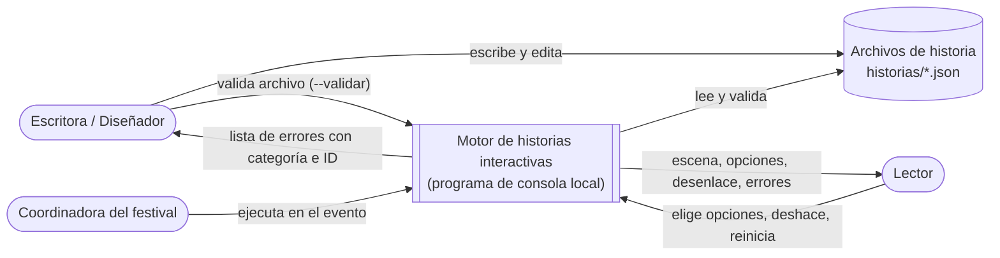
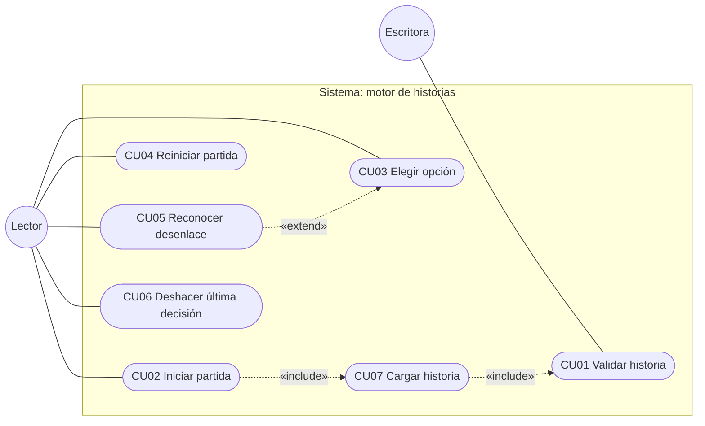
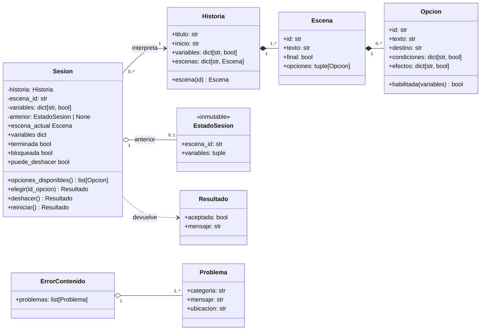
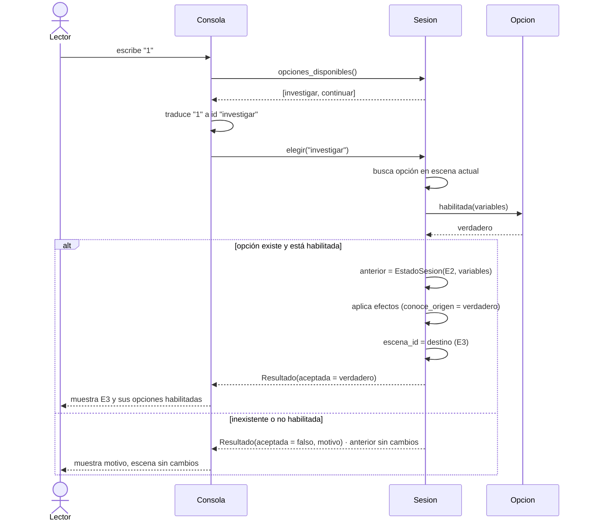
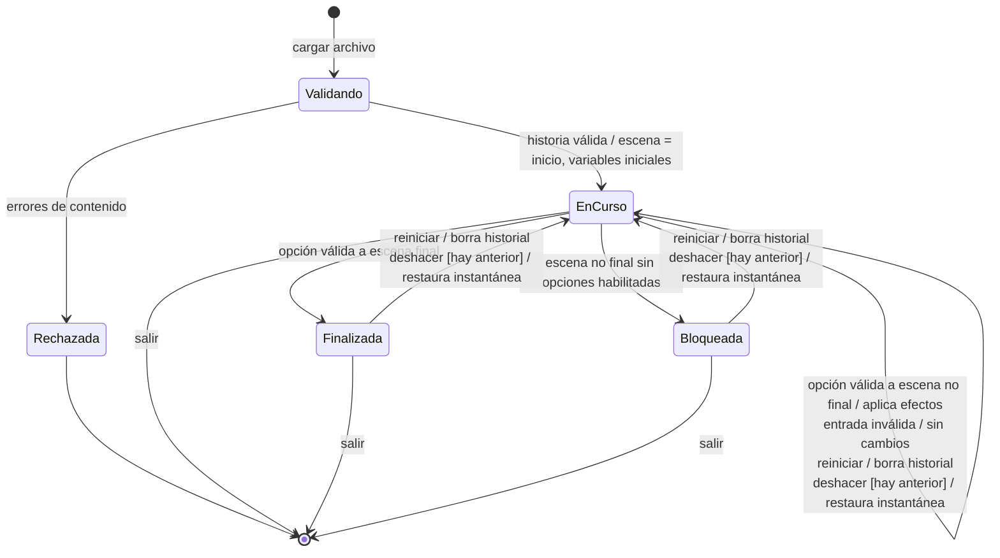

## A1. Diagrama de contexto

## A2. Diagrama de casos de uso

| Caso de uso | RF relacionados |
|---|---|
| CU01 Validar historia | RF11, RF12, RF13 |
| CU02 Iniciar partida / CU07 Cargar historia | RF01, RF02, RF03, RF04 |
| CU03 Elegir opción | RF04, RF05, RF06, RF07, RF08, RF14 |
| CU04 Reiniciar partida | RF10, RF14 |
| CU05 Reconocer desenlace | RF09 |
| CU06 Deshacer última decisión (SC01) | RF15, RF16, RF17 |

## A3. Diagrama de clases del dominio

## A4. Diagrama de secuencia: elegir una opción

## A5. Diagrama de estados de una sesión

