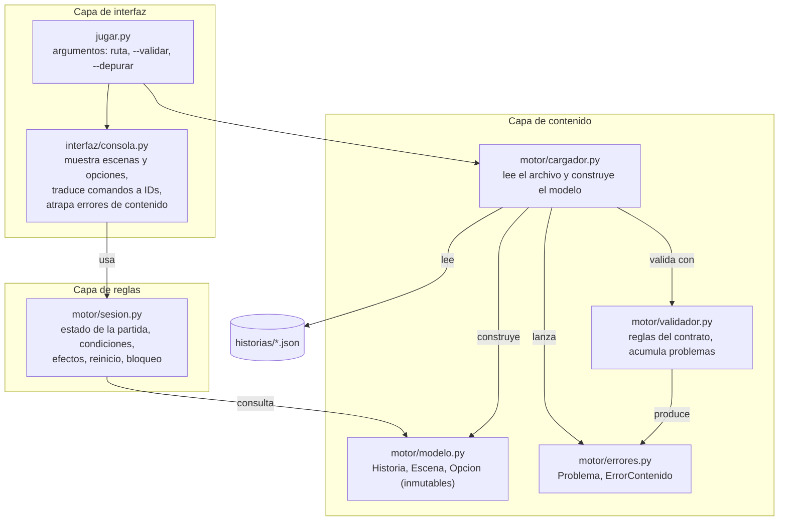

## A6. Diagrama de componentes por capas

Regla de dependencia: las flechas solo apuntan hacia capas inferiores. `motor/` no importa nada de `interfaz/` ni conoce IDs de escenas o nombres de variables de una historia concreta.
