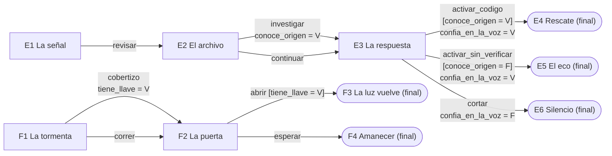
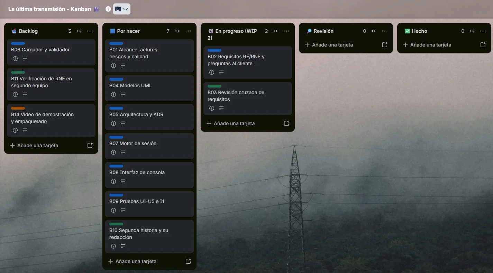
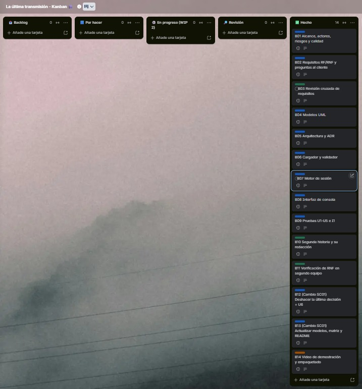

## A8. Mapa narrativo de las historias (datos de entrada, no modelo del software)

## A9. Tablero Kanban: capturas inicial y final

Tablero en **Trello** con las columnas *Backlog → Por hacer → En progreso (WIP 2) → Revisión → Hecho* y las tarjetas B01-B14 de la sección 2 del informe. El responsable se indica con la etiqueta de color de cada tarjeta: **azul = Camilo Conde**, **verde = Miguel Jacome**, **naranja = ambos**.

**Captura inicial** (al comenzar el trabajo: B02 y B03 en curso, respetando el límite WIP de 2; sin las tarjetas del cambio):

**Captura final** (cierre: las 14 tarjetas en *Hecho*; B12 y B13 se agregaron al recibir la solicitud de cambio):

